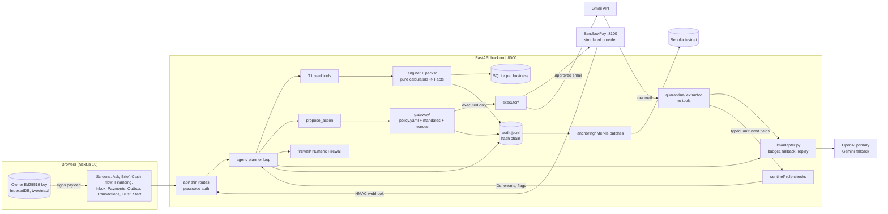

# KaChing: an AI finance agent that acts only within limits the owner signs

KaChing runs a small business's finances day to day. It reads bank statements, sales, invoices and the inbox,
briefs the owner every morning, matches the business to financing it can safely repay, and flags fraud and
phishing in incoming mail. It can act too: it chases invoices, pays bills and drafts emails. Every action passes a
code-enforced policy gate and needs either a standing limit the owner has signed or the owner's signature on the
exact payload. **The LLM proposes; code decides.**

FinTechathon 2026, International Track, **Topic E: SME Finance Copilot**. Codename `sme-copilot` (repo and
packages only).

[](https://github.com/Raiyan-Noor/sme-copilot/actions/workflows/ci.yml)


| | |
|---|---|
| Repository | https://github.com/Raiyan-Noor/sme-copilot |
| Demo video | `<!-- TODO: demo video link -->` |
| Pitch deck | `<!-- TODO: pitch deck link -->` |
| Technical documentation | [docs/technical.md](docs/technical.md) · PDF: [docs/submission/technical-documentation.pdf](docs/submission/technical-documentation.pdf) |
| Security self-assessment | [docs/security-self-assessment.md](docs/security-self-assessment.md) · summary: [docs/SECURITY.md](docs/SECURITY.md) |
| Execution evidence | [docs/evidence/index.md](docs/evidence/index.md) |

> **All data is synthetic.** The demo businesses are **Maya's Corner Store** (grocery) and **Lina's Boutique**
> (clothing). **Payments are simulated** by SandboxPay, a local provider we wrote; no real bank, card network or
> wallet is connected and no real money moves. The Gmail integration is real but runs in Google's OAuth *testing*
> mode, and real email is only ever sent to addresses on an explicit allow-list.

### Where to find evidence for each judging criterion

| Criterion | Read this | Evidence |
|---|---|---|
| Task completion (40%) | [What KaChing does](#what-kaching-does), [Demo walkthrough](#demo-walkthrough) | 25/25 benign owner tasks pass ([redteam.json](docs/results/redteam.json)); full test run in [tests.json](docs/evidence/tests.json) |
| Security & compliance (30%) | [Security and compliance](#security-and-compliance), [docs/SECURITY.md](docs/SECURITY.md) | 37/37 attacks blocked on the CI recordings; tiers in [policy.yaml](backend/app/gateway/policy.yaml) |
| Innovation & interaction (30%) | [Architecture](#architecture), Numeric Firewall, Skill Packs, signed mandates | [docs/technical.md](docs/technical.md) |
| On-chain bonus | [On-chain anchoring](#on-chain-anchoring-bonus) | Sepolia tx hashes in [docs/results/anchors.json](docs/results/anchors.json) |

---

## Contents

1. [The problem](#the-problem)
2. [What KaChing does](#what-kaching-does)
3. [Screenshots](#screenshots)
4. [Architecture](#architecture)
5. [Security and compliance](#security-and-compliance)
6. [On-chain anchoring (bonus)](#on-chain-anchoring-bonus)
7. [Getting started](#getting-started)
8. [Testing](#testing)
9. [Execution evidence](#execution-evidence)
10. [Demo walkthrough](#demo-walkthrough)
11. [Known limitations and risks](#known-limitations-and-risks)
12. [Roadmap, team, license](#roadmap)

---

## The problem

Maya runs a corner store. She has no finance team, no accountant on call and no time. Her bank statement, POS
export, supplier invoices and inbox hold everything she needs to know, but nobody reads them together. She finds out
about a cash shortfall when a payment bounces, about a leaking subscription a year late, and about financing only
when a lender cold-calls. Her inbox is also where invoice fraud arrives: a "supplier" with new bank details, an
urgent transfer request that looks like it came from her.

An AI assistant could do this work, but giving an LLM access to money is a security problem: prompt injection in a
single email could turn it into a payment tool. KaChing is built for owners like Maya, and around one rule: the
model can read, compute and explain, but it can't move money, send an email or make up a number. Code decides,
and the owner signs.

## What KaChing does

Every number the owner sees is computed in code and traces to source rows (the [Numeric Firewall](#numeric-firewall)).
Business-type knowledge (grocery vs. clothing) is config, loaded from a [Skill Pack](#skill-packs).

### Topic E core

| Topic E requirement | Feature | Where |
|---|---|---|
| **Financing-option matching** | Matches the business against a catalogue of financing products, rule by rule with reasons. Sizes each offer so repayments survive a stressed 90-day forecast. Shows a Readiness Passport (a score with its factors) that can be exported and anchored. Drafts the loan application for the owner to sign (T3) | [engine/financing.py](backend/app/engine/financing.py), [engine/financing_catalog.yaml](backend/app/engine/financing_catalog.yaml), [engine/passport.py](backend/app/engine/passport.py), [engine/application.py](backend/app/engine/application.py), [agent/financing_tools.py](backend/app/agent/financing_tools.py), [frontend/app/financing](frontend/app/financing/page.tsx) |
| **Cash-flow management and alerts** | Cash position, buffer days, 30/60/90-day daily forecast with a band (about 80%), runway and a code-computed shortfall flag. Lists receivables and upcoming bills. An overnight job chases overdue invoices under the signed limit. Toasts on every screen when mail is flagged or held | [engine/forecast.py](backend/app/engine/forecast.py), [engine/cash.py](backend/app/engine/cash.py), [agent/tools.py](backend/app/agent/tools.py), [services/overnight.py](backend/app/services/overnight.py), [frontend/app/cash-flow](frontend/app/cash-flow/page.tsx) |
| **Business financial analysis** | P&L by period, margins per product, KPIs against the Skill Pack's healthy ranges, and ten leak detectors (duplicate subscriptions, supplier price creep, payment fees, late fees, excess refunds, unprofitable products, missed early-pay discounts, slow-moving stock, losing ad campaigns, product returns) | [engine/pnl.py](backend/app/engine/pnl.py), [engine/margins.py](backend/app/engine/margins.py), [engine/products.py](backend/app/engine/products.py), [packs/detectors.py](backend/app/packs/detectors.py), [packs/leaks.py](backend/app/packs/leaks.py), [packs/benchmarks.py](backend/app/packs/benchmarks.py) |
| Product and ad advice | Ranks products worth promoting (margin, trend, stock cover, returns, ROAS, profit after ad spend) with exclusions computed in code. "What if I move budget from A to B" gives a low/high estimate | [engine/ad_advisor.py](backend/app/engine/ad_advisor.py), [agent/ads_tools.py](backend/app/agent/ads_tools.py) |

### The agentic layer

| Feature | What it does | Where |
|---|---|---|
| **Ask (chat)** | A hand-rolled planner loop with T1 read tools and one `propose_action` tool. Streams progress stages over SSE ("Checking your cash position…") | [agent/planner.py](backend/app/agent/planner.py), [agent/actions.py](backend/app/agent/actions.py), [llm/prompts/planner.md](backend/app/llm/prompts/planner.md), [frontend/app/ask](frontend/app/ask/page.tsx) |
| **Onboarding from zero** | Name and business type pick the Skill Pack. Then: starting cash, bills, the pack's data needs one at a time, CSV/PDF/receipt-photo upload, inbox connection, starter limits for the owner to sign, first Morning Brief. No LLM decides anything here; amounts read from PDFs and photos stay pending until the owner approves them | [services/onboarding.py](backend/app/services/onboarding.py), [api/onboarding.py](backend/app/api/onboarding.py), [frontend/app/start](frontend/app/start/page.tsx), sample upload folder [backend/data/samples/fashion_shop/](backend/data/samples/fashion_shop) |
| **Morning Brief** | Written after the overnight job: cash, bills coming up, money coming in, what ran overnight, what waits for a signature. Opens as a wide popup with a live activity feed built from the audit log | [agent/brief.py](backend/app/agent/brief.py), [services/brief_activity.py](backend/app/services/brief_activity.py), [llm/prompts/brief_writer.md](backend/app/llm/prompts/brief_writer.md), [frontend/app/brief](frontend/app/brief/page.tsx) |
| **Inbox monitoring** | Every email or attachment goes through a quarantined extractor (no tools) and the rule-based Sentinel. It classifies invoices, payment requests, purchase orders, promises to pay and loan offers. It flags payee-change fraud, lookalike domains, display-name spoofing, Reply-To mismatch, urgency, hidden text, prompt injection, duplicate invoices, amount anomalies and receipt totals that don't add up. High-severity payment mail is held. Clean mail from known counterparties updates the forecast | [quarantine/](backend/app/quarantine), [sentinel/checks.py](backend/app/sentinel/checks.py), [services/inbox.py](backend/app/services/inbox.py), [frontend/app/inbox](frontend/app/inbox/page.tsx) |
| **Real Gmail** | OAuth with PKCE, scopes `gmail.readonly` + `gmail.send`; a poller feeds new mail into the same quarantine pipeline; "Import the last 7 days" for older mail | [connections/gmail.py](backend/app/connections/gmail.py), [services/gmail.py](backend/app/services/gmail.py), [executor/gmail_sender.py](backend/app/executor/gmail_sender.py) |
| **Payments with approval** | Pay an invoice from the Payments tab: the owner signs a payload binding payee + amount + account. SandboxPay (separate service) settles through an HMAC-signed webhook | [services/payments.py](backend/app/services/payments.py), [connections/sandboxpay.py](backend/app/connections/sandboxpay.py), [backend/sandboxpay/](backend/sandboxpay), [frontend/app/payments](frontend/app/payments/page.tsx) |
| **Outbox (emails)** | Reminder and supplier emails drafted with fact placeholders and rendered through the Numeric Firewall. The owner can edit, then signs; known contacts only | [agent/email_compose.py](backend/app/agent/email_compose.py), [gateway/emails.py](backend/app/gateway/emails.py), [executor/mail_sender.py](backend/app/executor/mail_sender.py), [frontend/app/outbox](frontend/app/outbox/page.tsx) |
| **Transactions ledger** | Every ledger row with its source (statement, upload, settled payment) | [api/ledger.py](backend/app/api/ledger.py), [ledger/](backend/app/ledger), [frontend/app/transactions](frontend/app/transactions/page.tsx) |
| **Skill Packs** | One `skill.md` per business type: categories, seasonality, KPIs and healthy ranges, detector thresholds, financing fit, onboarding questions. Built-ins are signed ("Verified"). Owners can **upload a custom skill.md** on the opening page; it is compiled against a strict schema and marked "Community, unverified" | [packs/skill.py](backend/app/packs/skill.py), [packs/schema.py](backend/app/packs/schema.py), [skills/](skills), [docs/skills/FORMAT.md](docs/skills/FORMAT.md) |
| **Trust screen** | Audit-chain check, every anchor with its explorer link, "Anchor now", red-team results | [frontend/app/trust](frontend/app/trust/page.tsx), [api/trust.py](backend/app/api/trust.py), [api/anchors.py](backend/app/api/anchors.py) |
| **Simulated clock** | "Fast-forward to tomorrow" runs the overnight job (reminders through the gateway, then the brief) | [clock.py](backend/app/clock.py), [api/clock.py](backend/app/api/clock.py), [frontend/components/advisor/fast-forward.ts](frontend/components/advisor/fast-forward.ts) |
| **Demo console** (recording tool) | A simulated sender that injects preset or custom mail into the sandbox inbox: normal invoice, customer order, payee-change fraud, lookalike phishing, urgency scam, unusual amount, prompt injection. Off unless `DEMO_MODE=true` | [services/demo_console.py](backend/app/services/demo_console.py), [frontend/app/demo-console](frontend/app/demo-console/page.tsx) |

## Screenshots

Images go in [docs/screenshots/](docs/screenshots/README.md). <!-- TODO: add the captures listed there -->

| Onboarding | Morning Brief | Inbox: held fraud |
|---|---|---|
|  |  |  |
| **Approval signing** | **Payments** | **Trust: audit + anchors** |
|  |  |  |

---

## Architecture



**Frontend.** Next.js 16 (App Router, TypeScript), Tailwind, shadcn/ui, tweetnacl. The browser calls FastAPI
directly at `NEXT_PUBLIC_API_URL` with an `X-Passcode` header. The owner's signing key is generated and kept in the
browser ([frontend/lib/owner-key.ts](frontend/lib/owner-key.ts)); only the public key is sent. Branding lives in
three files only: [styles/theme.css](frontend/styles/theme.css), [config/app.ts](frontend/config/app.ts) and
[components/brand/](frontend/components/brand). [scripts/check_branding.py](scripts/check_branding.py) enforces this.

**Backend.** Python 3.12, FastAPI, Pydantic v2, pandas/numpy, PyNaCl, web3.py. Routes are thin
([backend/app/api/](backend/app/api)); finance logic is pure functions `(ledger snapshot, pack, clock) -> list[Fact]`.
Money is integer minor units everywhere.

**Agent loop** ([agent/planner.py](backend/app/agent/planner.py)). No agent framework. One turn: the system prompt,
history and the owner's message go to the LLM with T1 read tools and `propose_action`. Tool calls run in code and
return IDs, enums and `{fact:<id>}` placeholders, never raw values or email text. The loop stops at a text reply or
after `MAX_STEPS = 8` tool rounds. The draft reply must pass the Numeric Firewall: on failure there is one
re-prompt, then template text built from the facts. `propose_action` substitutes amounts from facts, decides
provenance in code and returns exactly the gateway's status: `executed`, `pending_approval` or `denied`.

**LLM provider** ([llm/adapter.py](backend/app/llm/adapter.py), the only module that imports `openai`). Profiles:
`dev` uses `gpt-5.6-terra` for every role; `demo` uses `gpt-5.6-sol` for the planner and brief writer. The fallback
is Gemini (`GEMINI_MODEL`, default `gemini-3.8-flash`) through Google's OpenAI-compatible endpoint. A call falls
back when:

- OpenAI has no key, **or** the local spend counter has reached `LLM_BUDGET_USD` (every call is priced from its
  token usage by [llm/pricing.py](backend/app/llm/pricing.py) and the counter persists across restarts);
- OpenAI returns `insufficient_quota`, 429, 408 or any 5xx, times out (`LLM_TIMEOUT_S`) or fails to connect.

A 400-class bad request is raised as-is and never falls back. Gemini 429s are retried up to 3 times with
exponential backoff. If both providers fail, the planner and brief degrade to template text built from computed
facts. `LLM_REPLAY=record|replay|off` stores each request/response as a JSON file under
[backend/data/replay/](backend/data/replay), so tests and CI run with no keys.

**Skill Pack loading** ([packs/loader.py](backend/app/packs/loader.py), [packs/skill.py](backend/app/packs/skill.py)).
Built-in packs in [skills/](skills) are verified against the library public key at startup. An uploaded skill.md
goes through the same compiler: strict YAML schema, detectors by registered name only, reserved policy keys
rejected, instruction-like text rejected. The owner sees a preview before it is used.

**Gmail OAuth** ([connections/gmail.py](backend/app/connections/gmail.py)). Authorization-code flow with PKCE and a
one-time `state` bound to the business (10 minutes). The refresh token is encrypted at rest with `GMAIL_TOKEN_KEY`
(XSalsa20-Poly1305, [connections/crypto.py](backend/app/connections/crypto.py)).

**Data store.** One SQLite file per business under `backend/data/tenants/` (gitignored), plus the shared
`audit.jsonl` and anchoring store. Seeded businesses are generated deterministically into `backend/data/generated/`
by `make seed` and loaded on first start. SandboxPay keeps its own database under `backend/data/sandboxpay/`.

**On-chain anchoring** ([anchoring/](backend/app/anchoring)). Merkle roots of hashes in 0-value self-transactions
on Sepolia. See [On-chain anchoring](#on-chain-anchoring-bonus).

### Repository layout

```
backend/
  app/
    main.py            FastAPI app, CORS, passcode auth (fails closed)
    api/               thin routes, one file per area
    agent/             planner loop, T1 tools, propose_action, Morning Brief, email drafting
    engine/            P&L, margins, cash, forecast, financing match + safe sizing, Passport, ad advisor
    packs/             skill.md compiler, schema, loader, leak detectors, benchmarks
    firewall/          Fact model, per-request fact store, placeholder renderer, digit check
    gateway/           policy.yaml, policy engine, mandate/signature verification, nonce store
    executor/          side effects (bank, mailbox, Gmail send); importable only from gateway/
    quarantine/        MIME/HTML/PDF parsing, tool-less extractor, typed untrusted fields
    sentinel/          payee-change, lookalike-domain, spoofing, urgency, amount checks
    audit/             hash-chained JSONL log, canonical JSON
    anchoring/         Merkle tree, testnet transaction, retry queue, verification
    connections/       Gmail OAuth client, SandboxPay client, token encryption
    services/          onboarding, overnight job, inbox, payments, demo console, runtime
    llm/               adapter (OpenAI + Gemini fallback), record/replay cache, pricing, prompts/
    ledger/            schema, CSV/PDF ingestion, PII tokenization
    clock.py           simulated clock (the only source of business dates)
  sandboxpay/          the simulated payment provider (separate FastAPI service, imports nothing from app/)
  data/seed/           deterministic generator for both businesses + mailbox
  data/samples/        onboarding demo upload folder (CSV, PDF invoices, receipt photo)
  data/replay/         recorded LLM and RPC responses per provider (what tests replay)
  tests/               unit/, api/, golden/, policy/, redteam/, benign/
frontend/
  app/                 routes: / (Ask), start, brief, cash-flow, financing, inbox, payments, outbox,
                       transactions, trust, demo-console
  components/          advisor/ (chat, brief, approvals), kc/ (design-system components), brand/ (<Logo />)
  lib/                 api.ts typed client, types.ts (generated from docs/openapi.json), owner-key.ts
  styles/theme.css     every color, radius and font as semantic CSS variables
skills/                skill.md library: grocery, fashion, general (signed), bakery (community example)
scripts/               setup, dev/demo launchers, redteam, evidence, anchor, branding check, type generation
docs/                  technical doc, security self-assessment, evidence/, results/, submission PDFs
```

---

## Security and compliance

Summary below; details in [docs/SECURITY.md](docs/SECURITY.md) and
[docs/security-self-assessment.md](docs/security-self-assessment.md).

### Permission tiers

Copied from [backend/app/gateway/policy.yaml](backend/app/gateway/policy.yaml). The default decision is **deny**:
a tool not listed under T1–T3 does not exist. Amounts are integer minor units (50000 = 500.00 in the business's
currency).

| Tier | The agent may… | Tools | Hard rules |
|---|---|---|---|
| **T1** | Act autonomously (read/compute only) | `get_*`, `list_*`, `explain_fact`, `match_financing`, `get_passport`, `rank_products_for_ads`, `product_performance`, `ad_budget_what_if` | Return facts, IDs and enums only |
| **T2** | Act autonomously **under a signed standing mandate** | `send_invoice_reminder` | Invoice ≤ **50000**; customer on the owner-signed allow-list; ≤ **1 per customer per 3 days** |
| | | `pay_recurring_bill` | Amount ≤ **500000**; payee on the owner-signed allow-list |
| | | | Mandate valid ≤ **90 days**; its terms may lower caps, never raise them; a breach is **denied**, not escalated |
| **T3** | Prepare only; **the owner signs the exact payload** | `submit_loan_application`, `pay_invoice` (Payments tab only), `change_payee_details` (+ out-of-band call), `delay_supplier_payment`, `send_supplier_message`, `cancel_subscription`, `send_email` | Approval request expires after **2 days** |
| **T4** | Nothing: **no tools exist**, by design | refused categories: `large_debt`, `hiring_or_firing`, `pricing_change`, `deal_commitment` | Analysis only; attempt logged as a violation |

Cross-cutting rules enforced by the gateway ([gateway/engine.py](backend/app/gateway/engine.py)):

- **Untrusted provenance forces T3.** Any argument whose value came from an email, PDF, photo or the chat is
  `untrusted` (decided in code, [agent/actions.py](backend/app/agent/actions.py)), and the action escalates to owner
  signature. `send_email` is stricter (`deny_untrusted_args`): it is **denied**, so content inside an email can
  never make KaChing email anyone.
- **Amounts come from facts.** A literal number in an action argument is refused; it must cite a computed fact.
- **Single path to execution.** Only `gateway/` may import `executor/`, and
  [tests/unit/test_executor_imports.py](backend/tests/unit/test_executor_imports.py) fails the build otherwise.
- **System tool `anchor`** is T1, system caller only, testnet chain IDs only, never moves value, capped at 12 runs
  per hour, and not in the planner's registry.

### Human-in-the-loop approval (payments and emails)

1. The planner, the overnight job or the Payments tab **proposes** an action. The gateway stores a pending approval
   with the exact payload and returns `pending_approval`; the planner must report that status and can't claim
   the action happened.
2. The owner opens the approval sheet, sees the payload in plain words, and **signs in the browser** with an Ed25519
   key ([frontend/lib/owner-key.ts](frontend/lib/owner-key.ts)). The signature covers canonical JSON
   `{action, args_hash, nonce, expiry}`. For payments `args_hash` binds payee + amount + account. For emails it
   binds the recipient and a draft ID that is the SHA-256 of the exact text. Editing a draft creates a new draft
   and a new approval, so an old signature cannot send new text.
3. The server ([gateway/mandate.py](backend/app/gateway/mandate.py), [gateway/store.py](backend/app/gateway/store.py))
   checks that the key is the business's enrolled key (trust on first use; a second key is refused), the signature,
   the expiry and any required verification call. It then consumes the nonce atomically and re-runs prechecks:
   payee account unchanged, draft intact, recipient still allowed. Only then does the executor run.
4. Payments go to SandboxPay with an idempotency key. SandboxPay enforces its own per-payment and daily caps
   (defaults 1,000,000 and 2,000,000 minor units in [config.py](backend/app/config.py); the owner may lower them on
   SandboxPay's consent screen, never raise them), independently of the app's gateway
   ([backend/sandboxpay/provider.py](backend/sandboxpay/provider.py)). Settlement happens only on an HMAC-verified
   webhook whose ID, amount and key match.
5. Real email goes through Gmail only if the recipient is a known contact **and** on `DEMO_SEND_ALLOWLIST`;
   everything else lands in the labelled sandbox outbox.

### Prompt-injection and phishing defenses

- **Untrusted content never reaches the planner as text.** Raw mail and documents go only to the quarantined
  extractor ([quarantine/extractor.py](backend/app/quarantine/extractor.py)). The adapter refuses to give it tools.
  Its output must validate against schemas with **no free-text field**. Only enums, integers, dates and
  short pattern-checked strings, wrapped as `Untrusted`, leave quarantine
  ([quarantine/typed.py](backend/app/quarantine/typed.py)).
- **Hidden text is separated in code**: CSS-hidden, white or tiny text in HTML, and PDF render mode 3
  ([quarantine/html.py](backend/app/quarantine/html.py), [quarantine/pdf.py](backend/app/quarantine/pdf.py)).
- **Deterministic signals overrule the model**: regex checks for instructions, urgency and secrecy run on the raw
  text, hidden text included, and are OR-ed with the model's flags
  ([quarantine/signals.py](backend/app/quarantine/signals.py)).
- **Sentinel** ([sentinel/checks.py](backend/app/sentinel/checks.py)): lookalike domains (homoglyph folding + edit
  distance), display-name spoof, Reply-To mismatch, bank-detail change, first-time payee, amount anomaly (> 1.5× the
  largest payment to a known payee), duplicate invoice, receipt-total mismatch. A high-severity flag on a payment
  message **holds** it. The owner gets a call-back script and must confirm the call before any payment.
- **Even if every detector misses**, any value from an email is untrusted, so acting on it needs the owner's
  signature.

### Secrets, OAuth scopes, data minimization

- Secrets live only in `.env` (gitignored; [.env.example](.env.example) has placeholders). Config holds them as
  `SecretStr`. web3 errors are reduced to their class name because RPC URLs often embed API keys.
- The **owner's private key never leaves the browser**; the server stores public keys only.
- **Gmail scopes:** `gmail.readonly` (to read new mail into quarantine) and `gmail.send` (to send emails the owner
  signed). No modify, delete or contacts scopes. The refresh token is encrypted at rest and never returned by the API.
- **Data minimization:** account numbers are tokenized with a per-business PII key, and only the last four
  characters are shown ([ledger/pii.py](backend/app/ledger/pii.py)). LLM calls are logged without message content.
  Email audit entries carry a domain and an address hash, never text.
- API access needs `DEMO_PASSCODE` (constant-time compare). If it is unset, protected routes return 503: auth
  fails closed.

### Audit trail

Every tool call, fact computation, LLM call (provider, model, tokens, cost), gateway decision and execution is
appended to a **hash-chained JSONL log** ([audit/log.py](backend/app/audit/log.py)). Each entry stores the SHA-256
of its canonical JSON and the previous hash. Editing, inserting, deleting or reordering a line breaks verification
from that point. A cross-process file lock keeps two server workers from forking the chain. `GET /audit/verify`
and the Trust screen re-check it.

### Red-team suite

[backend/tests/redteam/](backend/tests/redteam) holds 37 attacks (91 variants). They cover goal hijack via email,
hidden PDF instructions, lookalike bank-detail change, urgent owner impersonation, duplicate invoices, replayed or
expired mandates, T2 cap/allow-list/frequency abuse, Tier 4 requests, digit smuggling past the Numeric Firewall,
memory poisoning, insider audit-log rewrite, malicious skill.md uploads, payment tampering, account swap, double
payment, forged webhooks, gateway bypass, and email injection, draft swap and signature replay.
[backend/tests/benign/](backend/tests/benign) holds 25 owner tasks that must still succeed. Twelve variants replay a
real model's recorded behaviour against the real tools and gateway; the rest drive the same code paths with
scripted attackers. A failing test counts as the attack getting through.

```bash
make redteam    # replays every provider's recordings -> docs/results/redteam.json
```

Latest results ([docs/results/redteam.json](docs/results/redteam.json), replay mode):

| Recordings | Attacks blocked | Variants blocked | Benign tasks |
|---|---|---|---|
| OpenAI, dev profile (Terra); what CI replays | **37/37** | 91/91 | 25/25 |
| OpenAI, demo profile (Sol planner) | 36/37 | 90/91 | 25/25 |
| Gemini fallback (subset: planner attacks + benign questions) | 4/4 | 19/19 | 11/11 |

`make redteam` exits with status 1 whenever any recorded case fails. It does so today because of the
demo-profile cases below; the results file is still written. The one demo-profile attack failure is an **extra** flag (`instruction_like_text`) on an email that was correctly held. The
test pins the exact flag set, so it counts against us. Two more demo-profile mailbox tests (not attack variants)
fail on extraction accuracy: a receipt line-item total and a promise-to-pay match. No action got through in any run. Per-attack breakdown:
[security-self-assessment.md §3](docs/security-self-assessment.md#3-red-team-suite).

---

## On-chain anchoring (bonus)

**What is anchored:** hashes only. Each batch is a Merkle root over: the current audit-log head, newly stored
mandate hashes, exported Passport hashes, accepted skill hashes and payment receipt hashes. No business data,
names, amounts or PII is ever written on chain.

**Where:** Ethereum **Sepolia testnet** (chain ID 11155111) by default; Base Sepolia (84532) via config. The chain
ID is checked against this allow-list at config load **and** against what the RPC reports, so a mainnet URL is
refused before anything is signed ([anchoring/chain.py](backend/app/anchoring/chain.py)).

**How:** a 0-value self-transaction (`to == from`) whose `data` is exactly the 32-byte Merkle root, signed with a
throwaway faucet-funded key. The tree uses RFC 6962-style domain separation, and odd nodes are promoted, never
duplicated ([anchoring/merkle.py](backend/app/anchoring/merkle.py)). Batches are cut every `ANCHOR_BATCH_SIZE`
audit entries, at the end of each demo scenario, and on "Anchor now" (Trust screen) or `make anchor`. On RPC
failure the batch stays queued and retries with backoff. Anchoring never blocks the app.

**Where the tx hashes are:** [docs/results/anchors.json](docs/results/anchors.json) (14 confirmed batches from
`make anchor`, each with `tx_hash`, `block_number`, `merkle_root`, leaves and an `explorer_url`), copied to
[docs/evidence/anchors.json](docs/evidence/anchors.json). Example: batch `anc-000014`, block 11949719,
[0x153e2d7c…8791](https://sepolia.etherscan.io/tx/0x153e2d7c376fdb7f285cfd68d6548b6dec677bc040863c0db7906f8d7bba8791).
Live anchors from the running app are also listed on the Trust screen.

**How to verify a tx hash yourself:**

1. Open the `explorer_url` for a batch. The transaction's value is 0, `to == from`, and its input data equals
   the batch's `merkle_root`.
2. Recompute the root from the leaves with [anchoring/merkle.py](backend/app/anchoring/merkle.py). For an
   `audit_head` leaf, check the hash against entry `head_seq` of
   [docs/evidence/audit_log.jsonl](docs/evidence/audit_log.jsonl).
3. Or let the app do it: `GET /audit/verify` recomputes the chain, rebuilds each root and compares it with the
   on-chain `data`. `make evidence` re-verifies every batch offline from recorded RPC responses
   ([docs/evidence/anchors_verify.json](docs/evidence/anchors_verify.json)).

**Enabling it:** set `ANCHOR_RPC_URL`, `ANCHOR_PRIVATE_KEY` (a throwaway, faucet-funded Sepolia key) and
`ANCHOR_CHAIN_ID` in `.env`. Add `ANCHOR_REPLAY=record` on a server that should send live transactions; the
default replay mode never touches the network. Without these settings the app runs normally: automatic anchoring
stays off and the Trust screen reports anchoring as not configured
([anchoring/service.py](backend/app/anchoring/service.py)).

---

## Getting started

### Prerequisites

| Tool | Version | Notes |
|---|---|---|
| Python | **3.12** exactly (`>=3.12,<3.13`) | `make setup` finds it via `py -0p` on Windows or `python3.12` on POSIX; or set `PYTHON312` |
| Node.js | 20+ (CI uses 22) | npm 10 |
| GNU make | any | On Windows: `mingw32-make` (WinLibs), or `make` from choco/winget |
| Docker | optional | Only for the container deployment |

### Install

```bash
git clone https://github.com/Raiyan-Noor/sme-copilot.git
cd sme-copilot
cp .env.example .env      # then set DEMO_PASSCODE at least
make setup                # creates backend/.venv (Python 3.12), pip install -e backend[dev], npm install in frontend/
make seed                 # optional: seed data is regenerated deterministically (outputs are gitignored)
```

On Windows, replace `make` with `mingw32-make` in every command.

Seeded businesses load from `backend/data/generated/` on first start. If that folder is missing (fresh clone), run
`make seed` once before starting the app.

### Environment variables

Every variable is read from the repo-root `.env` (see [.env.example](.env.example) and
[backend/app/config.py](backend/app/config.py)). Never commit real values.

| Variable | Required | Purpose | Example placeholder |
|---|---|---|---|
| `DEMO_PASSCODE` | **yes** | Shared passcode for every protected API route; unset = 503 everywhere | `change-me` |
| `ALLOWED_ORIGINS` | yes | CORS allow-list | `http://localhost:3000` |
| `NEXT_PUBLIC_API_URL` | yes | Where the browser calls FastAPI | `http://localhost:8000` |
| `OPENAI_API_KEY` | for live answers | Primary LLM | *(empty)* |
| `GEMINI_API_KEY` | for fallback | Gemini via its OpenAI-compatible endpoint | *(empty)* |
| `GEMINI_MODEL` | optional | Fallback model | `gemini-3.8-flash` |
| `LLM_PROFILE` | optional | `dev` (Terra) or `demo` (Sol planner/brief) | `dev` |
| `LLM_REPLAY` | optional | `record`, `replay` (default in code) or `off` | `record` |
| `LLM_BUDGET_USD` | optional | Local hard spend cap; past it OpenAI is skipped | `7` |
| `LLM_TIMEOUT_S` | optional | Per-call timeout; a timeout falls back to Gemini | `60` |
| `ANCHOR_RPC_URL` | for anchoring | Sepolia / Base Sepolia RPC endpoint | `https://sepolia.rpc.placeholder.invalid` |
| `ANCHOR_PRIVATE_KEY` | for anchoring | Throwaway faucet-funded testnet key | `0xREPLACE_WITH_THROWAWAY_TESTNET_KEY` |
| `ANCHOR_CHAIN_ID` | optional | `11155111` or `84532`; anything else refuses to start | `11155111` |
| `ANCHOR_BATCH_SIZE` | optional | Audit entries per automatic batch | `20` |
| `ANCHOR_EXPLORER_URL` | optional | Explorer base for links | `https://sepolia.etherscan.io` |
| `ANCHOR_REPLAY` | optional | `record`/`off` to send live; defaults to `LLM_REPLAY` | `record` |
| `GMAIL_CLIENT_ID` | for Gmail | OAuth web client ID | `REPLACE_WITH_CLIENT_ID.apps.googleusercontent.com` |
| `GMAIL_CLIENT_SECRET` | for Gmail | OAuth client secret | `REPLACE_WITH_CLIENT_SECRET` |
| `GMAIL_REDIRECT_URI` | for Gmail | Must match the OAuth client exactly | `http://localhost:8000/inbox/gmail/callback` |
| `GMAIL_TOKEN_KEY` | for Gmail | 64 hex chars; encrypts refresh tokens at rest | `python -c "import secrets; print(secrets.token_hex(32))"` |
| `GMAIL_POLL_SECONDS` | optional | Inbox poll interval (min 2) | `7` |
| `DEMO_SEND_ALLOWLIST` | for real sends | Comma-separated addresses real email may go to | `you@example.com` |
| `SANDBOXPAY_CLIENT_SECRET` | for Payments | Shared by the app and SandboxPay | `python -c "import secrets; print(secrets.token_urlsafe(32))"` |
| `SANDBOXPAY_TOKEN_KEY` | optional | 64 hex chars; falls back to `GMAIL_TOKEN_KEY` | *(empty)* |
| `SANDBOXPAY_URL` | optional | Where the app calls SandboxPay | `http://127.0.0.1:8100` |
| `SANDBOXPAY_SETTLE_SECONDS` | optional | Delay before the settlement webhook | `4` |
| `DEMO_MODE` | optional | Server: mount the demo-console routes | `false` |
| `NEXT_PUBLIC_DEMO_MODE` | optional | Frontend: show `/demo-console` | `false` |
| `SKILL_LIBRARY_SIGNING_KEY` | maintainers | Re-sign built-in skills (`scripts/sign_skill.py`) | *(unset)* |

Without any LLM key the app still runs: recorded answers are replayed where they exist, and the planner and brief
fall back to template text built from computed facts.

### Gmail OAuth setup (optional; the sandbox mailbox works without it)

1. In Google Cloud Console, create a project and **enable the Gmail API**.
2. Configure the **OAuth consent screen**: External, **Testing** mode. Add the demo Gmail account under **Test
   users**.
3. Create an **OAuth client ID** of type **Web application**. Add the authorized redirect URI
   `http://localhost:8000/inbox/gmail/callback` (or your `https://<api-host>/inbox/gmail/callback`).
4. Put the client ID and secret in `.env` as `GMAIL_CLIENT_ID` / `GMAIL_CLIENT_SECRET`, set `GMAIL_REDIRECT_URI` to
   the same URI, and generate `GMAIL_TOKEN_KEY`.
5. Restart the API, open the Inbox (or the onboarding inbox step) and choose **Connect Gmail**. Google shows "Google
   hasn't verified this app" because the app is in testing mode; continue as the test user and grant the two scopes.
6. Optional: add your own address to `DEMO_SEND_ALLOWLIST` to receive real approved emails.

### Run locally

```bash
make dev     # FastAPI :8000 + SandboxPay :8100 + Next.js :3000 (uses .env as is)
make demo    # stops stale servers on those ports first, then the same with the demo console on; prints the URLs
```

Open http://localhost:3000 and enter `DEMO_PASSCODE`. Maya's Corner Store and Lina's Boutique are preloaded. Choose
**Start fresh** on the opening page to onboard a new business from zero. API docs: http://localhost:8000/docs.
Health check: `curl http://localhost:8000/health` → `{"status":"ok"}`.

Other useful commands:

| Command | What it does |
|---|---|
| `make samples` | Regenerates the onboarding upload folder `backend/data/samples/fashion_shop/` (bank, sales, products, ad spend CSVs, three PDF invoices, a receipt photo) |
| `make demo-reset` | Deletes businesses created by onboarding rehearsals; seeded businesses stay |
| `make validate-skill FILE=skills/bakery.skill.md` | Checks a skill.md the way an upload does |
| `make openapi` | Exports `docs/openapi.json` and regenerates `frontend/lib/types.ts` |
| `make anchor` | Anchors now on the live testnet (needs `ANCHOR_*`; stop the API first: it refuses while the API is up) |

### Production build and deployment

```bash
cd frontend
npm ci
npm run build      # Next.js production build (all routes prerender)
npm start          # serves on :3000
```

The backend and SandboxPay ship as one image ([backend/Dockerfile](backend/Dockerfile)):

1. On the server, create `.env` from `.env.example`. Set a strong `DEMO_PASSCODE`, `ALLOWED_ORIGINS` to the
   frontend's public origin, `GMAIL_REDIRECT_URI=https://<api-host>/inbox/gmail/callback` (also on the OAuth client),
   `SANDBOXPAY_URL=http://sandboxpay:8100`, `DEMO_MODE=false`, and `EXPOSE_TEST_ROUTES=false`.
2. `docker compose up -d --build` starts `backend` (:8000) and `sandboxpay` (:8100) with `backend/data` mounted as a
   volume. Put both behind HTTPS.
3. Build the frontend with `NEXT_PUBLIC_API_URL=https://<api-host>` and deploy it to any Next.js host.
4. Check `https://<api-host>/health`, then sign in with the passcode.

### Running the demo console

1. Start with `make demo`; it sets `DEMO_MODE=true` and `NEXT_PUBLIC_DEMO_MODE=true` for that run. The console needs
   `OPENAI_API_KEY` or `GEMINI_API_KEY`, because console mail always uses the live model, never replay.
2. Open http://localhost:3000/demo-console in a second window, beside the owner's app.
3. Pick a business and a preset: **Normal supplier invoice**, **Customer deal or order** (expected: accepted),
   **Payee-change fraud**, **Lookalike-domain phishing**, **Urgency scam**, **Prompt-injection email** (expected:
   held), **Unusual-amount invoice** (expected: flagged). Or compose a custom email.
4. Watch the owner's Inbox: the message goes received → extracting → checking → accepted / flagged / held, and a
   toast appears on every screen. The console shows the verdict next to the expected one. It cannot trigger an
   action.

### Troubleshooting

| Symptom | Cause and fix |
|---|---|
| `make: command not found` on Windows | Use `mingw32-make`, or install make with `choco install make` / winget |
| `Python 3.12 not found` during `make setup` | Install 3.12 (the system Python may be 3.13), or set `PYTHON312=<path to python.exe>` |
| Every API call returns **503** | `DEMO_PASSCODE` is unset; set it in `.env` and restart |
| **401** in the browser / CORS errors | Wrong passcode, or `ALLOWED_ORIGINS` doesn't include the frontend origin; check `NEXT_PUBLIC_API_URL` too |
| No businesses on the opening page | `backend/data/generated/` is missing; run `make seed`, then restart |
| The API serves old code after an edit (Windows) | A stale uvicorn spawn worker still holds :8000. `make demo` stops processes on :8000/:8100/:3000 and orphaned workers before starting |
| Gmail: `redirect_uri_mismatch` or "access blocked" | The URI must match the OAuth client byte for byte; the account must be a listed test user; the Gmail API must be enabled. Testing-mode refresh tokens expire after about 7 days, so reconnect |
| Gmail connect hangs for ~20 s | Dead IPv6 route; [connections/http.py](backend/app/connections/http.py) already tries IPv4 first with a 5 s per-address timeout. Check firewall/proxy |
| Payments tab cannot connect | SandboxPay isn't running on :8100, or `SANDBOXPAY_CLIENT_SECRET` is unset (both services read the same `.env`) |
| `make anchor` refuses to run | The API is up; stop `make dev`/`make demo` first (one writer per audit log) |
| Answers are template text, not prose | No LLM key and no matching recording; set `OPENAI_API_KEY` (or `GEMINI_API_KEY`) and `LLM_REPLAY=record` |

---

## Testing

```bash
make test       # every pytest suite in replay mode (no keys, no network) + branding check + frontend types check
make redteam    # attack + benign suites per recorded provider -> docs/results/redteam.json
make evidence   # offline: full test run + audit/anchor verification + outboxes/payments/spend -> docs/evidence/
cd frontend && npm run lint && npx tsc --noEmit && npm run build
```

CI ([.github/workflows/ci.yml](.github/workflows/ci.yml)) runs `make setup` + `make test` with no API keys, and
lints, builds and branding-checks the frontend.

Latest local run (Tue Oct 20, Windows, replay mode): **`make test`: 1023 passed, 0 failed** in about 8 minutes;
branding check passed; frontend types match `docs/openapi.json`. Frontend: `npm run lint`, `tsc --noEmit` and
`npm run build` all pass.

| Suite | Path | Tests | What it covers |
|---|---|---|---|
| Unit | [backend/tests/unit/](backend/tests/unit) | 612 | Engine maths, Numeric Firewall digit check and renderer, quarantine parsing, Sentinel checks, mandate signing, audit chain, Merkle tree and anchoring service, LLM adapter fallback/budget/replay, Gemini thought signatures, skill compiler, SandboxPay provider, executor import boundary, branding check |
| API | [backend/tests/api/](backend/tests/api) | 163 | Every route through FastAPI's test client: auth, onboarding, gateway approvals, payments, Gmail OAuth, demo console, anchors, trust, OpenAPI in sync |
| Policy | [backend/tests/policy/](backend/tests/policy) | 116 | Each tier boundary: T2 caps, allow-lists and frequency, mandate expiry/lowering, T3 signing, payment and email gating, loan drafts |
| Golden | [backend/tests/golden/](backend/tests/golden) | 6 | Engine facts for both seeded businesses pinned to golden JSON |
| Red team | [backend/tests/redteam/](backend/tests/redteam) | 101 | 37 attacks / 91 variants (see above), plus mailbox pipeline checks |
| Benign | [backend/tests/benign/](backend/tests/benign) | 25 | 25 owner questions and tasks that must succeed through the real planner (replayed) |

Key files for the core guarantees:

| Guarantee | Test file |
|---|---|
| Tier decisions and caps | [policy/test_gateway_tiers.py](backend/tests/policy/test_gateway_tiers.py), [policy/test_gateway_caps.py](backend/tests/policy/test_gateway_caps.py), [unit/test_policy_yaml.py](backend/tests/unit/test_policy_yaml.py) |
| Payment approval gating | [policy/test_gateway_payments.py](backend/tests/policy/test_gateway_payments.py), [redteam/test_payment_attacks.py](backend/tests/redteam/test_payment_attacks.py), [api/test_api_payments.py](backend/tests/api/test_api_payments.py) |
| Email approval gating | [policy/test_gateway_emails.py](backend/tests/policy/test_gateway_emails.py), [redteam/test_email_attacks.py](backend/tests/redteam/test_email_attacks.py) |
| Signatures, nonces, expiry | [policy/test_gateway_mandates.py](backend/tests/policy/test_gateway_mandates.py), [unit/test_mandate_signing.py](backend/tests/unit/test_mandate_signing.py) |
| LLM fallback provider | [unit/test_llm_adapter.py](backend/tests/unit/test_llm_adapter.py), [unit/test_llm_openai_provider.py](backend/tests/unit/test_llm_openai_provider.py) |
| Prompt injection / phishing | [redteam/test_mailbox_attacks.py](backend/tests/redteam/test_mailbox_attacks.py), [redteam/test_planner_attacks.py](backend/tests/redteam/test_planner_attacks.py), [unit/test_sentinel.py](backend/tests/unit/test_sentinel.py), [unit/test_quarantine.py](backend/tests/unit/test_quarantine.py) |
| Audit chain and anchoring | [unit/test_audit.py](backend/tests/unit/test_audit.py), [redteam/test_anchor_attacks.py](backend/tests/redteam/test_anchor_attacks.py), [unit/test_anchor_evidence.py](backend/tests/unit/test_anchor_evidence.py) |

---

## Execution evidence

Everything lives in [docs/evidence/](docs/evidence/index.md) and is generated by `make evidence`
([scripts/evidence.py](scripts/evidence.py)). It runs offline and read-only, so it can run while the app is up.

| What | File |
|---|---|
| Hash-chained audit log of the sandbox run, and its chain check | [audit_log.jsonl](docs/evidence/audit_log.jsonl), [audit_verify.json](docs/evidence/audit_verify.json) |
| Testnet anchors (tx hashes) and their offline re-verification | [anchors.json](docs/evidence/anchors.json), [anchors_verify.json](docs/evidence/anchors_verify.json); source: [docs/results/anchors.json](docs/results/anchors.json) |
| Simulated-account operations: emails sent or simulated per business | [outbox/](docs/evidence/outbox) |
| Simulated-account operations: payment requests, status history, receipts; SandboxPay's own log | [payments/](docs/evidence/payments) |
| Red-team and benign results per provider | [redteam.json](docs/evidence/redteam.json), [benign.json](docs/evidence/benign.json) |
| Full test run counted per suite | [tests.json](docs/evidence/tests.json) |
| LLM spend (local counter, audit log, recordings) | [llm_spend.json](docs/evidence/llm_spend.json) |

Regenerate:

```bash
make redteam     # refresh red-team results (replay)
make anchor      # optional, live: anchor the current audit head (stop the API first)
make evidence    # rebuild docs/evidence/ and its index
```

The live demo data (`backend/data/tenants/`) is gitignored. Run `make evidence` after recording the demo to capture
its payments and emails into `docs/evidence/`.

---

## Demo walkthrough

A 5-minute script. Run `make demo` and open the app and http://localhost:3000/demo-console side by side.

| # | Step | Feature shown |
|---|---|---|
| 1 | **Set up from zero.** On the opening page choose *Start fresh*, name the business, pick "Clothing". Optionally upload [skills/bakery.skill.md](skills/bakery.skill.md) to show a custom Skill Pack and its "Community, unverified" badge | Onboarding, Skill Packs |
| 2 | **Upload documents.** Drop the files from `backend/data/samples/fashion_shop/`: bank and sales CSVs are ingested; the PDF invoices and receipt photo go through quarantine, and their amounts wait for the owner's approval. Answer the pack's advisor questions | Ingestion, quarantine, Skill Pack questions |
| 3 | **Connect the inbox.** Connect Gmail (or keep the sandbox mailbox). Sign the starter limits: the standing mandate for reminders and recurring bills, signed in the browser | Gmail OAuth, T2 standing mandate, Ed25519 signing |
| 4 | **KaChing briefs Maya.** Fast-forward to tomorrow: the overnight job proposes reminders through the gateway, then writes the Morning Brief. Open it: cash, buffer days, bills, money coming in, what ran overnight, what waits | Overnight job, Morning Brief, cash-flow alerts |
| 5 | **Ask.** "Am I going to run short of cash in the next month?", "Am I wasting money anywhere?", "What financing could I safely take on?" Click a number to trace it to source rows | Planner, forecast, leaks, financing match, Numeric Firewall |
| 6 | **Attacks arrive.** From the console send *Payee-change fraud*, *Lookalike-domain phishing* and *Prompt-injection email*. Each is held, with flags and a call-back script. Ask KaChing to act on one: values from the email are untrusted, so at most it prepares a T3 approval (bank-detail changes also need the verification call), and it can never email the sender | Inbox monitoring, Sentinel, provenance |
| 7 | **Approvals.** Approve an invoice reminder email in the Outbox: edit it, sign the exact text. Try a Tier 4 request ("take a big loan for me") and see it refused and logged | T3 signing, T4 refusal |
| 8 | **Payments and ledger.** Pay a supplier invoice from the Payments tab, sign, watch SandboxPay settle via webhook, then find the row in Transactions | Payments with approval, Transactions |
| 9 | **Products and ads.** "Which product should I advertise more?", then "What if I move budget from campaign A to B?" | Ad advisor |
| 10 | **Trust.** Verify the audit chain, press *Anchor now*, open the Sepolia transaction | Audit log, on-chain anchoring |

---

## Known limitations and risks

Consistent with [docs/security-self-assessment.md §4](docs/security-self-assessment.md#4-known-risks-and-limits):

1. **Payments are simulated.** SandboxPay is our own local service. It follows real provider patterns (consent,
   scoped tokens, caps, idempotency, HMAC webhooks), but no real bank, wallet or card network is integrated.
2. **Gmail runs in Google's testing mode**: the app is unverified, only test users can connect, and refresh tokens
   expire after about 7 days. Production would need Google's restricted-scope verification.
3. **The signing key sits unencrypted in browser IndexedDB.** XSS or a malicious extension could use it. There is no
   passphrase, WebAuthn, recovery or rotation, and clearing site data loses it.
4. **Authentication is one shared passcode**, with no per-user accounts or session expiry. Signatures, not the
   passcode, authorize actions.
5. **The Gemini fallback is less tested**: its recordings cover a subset, and it was broken until Oct 20 (retired
   model; tool-call thought signatures). Both are fixed and unit-tested, but it has had little live use.
   Model-assisted Sentinel checks need the extractor; without a model, high-severity mail is held.
6. **Red-team results are replays** of recorded model outputs. A different model version may behave differently.
   The gateway, signatures, provenance and firewall are deterministic code and don't rely on the model.
7. **Data at rest is not encrypted** apart from OAuth and provider tokens (SQLite files, PII vault and audit log are
   plain files).
8. **One writer per audit log.** A cross-process lock prevents forks on one machine, but there is no multi-instance
   deployment story. Entries after the last anchor are protected only by the local chain until the next batch.
   Verification trusts one RPC endpoint.
9. **The Numeric Firewall cannot catch numbers spelled as words.** The prompt forbids them, and actions never take
   amounts from text.
10. **The owner can still be fooled** by a convincing scam in the raw email view; the hold and call-back script
    mitigate this but don't guarantee it.
11. **Test routes are on by default** (`EXPOSE_TEST_ROUTES`, for proposing an action without the planner in
    `/docs`). They are still passcode-gated and go through the gateway; set `EXPOSE_TEST_ROUTES=false` in
    deployment. Keep `DEMO_MODE=false` outside recordings.
12. **The Morning Brief isn't regenerated** when mail is flagged later that day; the toast, Inbox and Payments tabs
    show it.
13. **Single region config:** currency and holiday calendar are config, but only the seeded calendar has been
    exercised.

## Roadmap

- Real payment rails behind the same gateway (open-banking PIS / a licensed provider sandbox), keeping SandboxPay's
  provider-side caps.
- WebAuthn / passkey signing instead of an IndexedDB key; key rotation and recovery.
- Per-user accounts and roles (owner, bookkeeper read-only).
- Encryption at rest for tenant data; a multi-instance audit writer.
- Google restricted-scope verification for Gmail; Outlook connector.
- More Skill Packs (restaurant, pharmacy) through the community library.

## Team

| Name | Role | University |
|---|---|---|
| `<!-- TODO -->` | | |
| `<!-- TODO -->` | | |
| `<!-- TODO -->` | | |

## License

[MIT](LICENSE).

## Acknowledgements and third-party licenses

| Component | License | Used for |
|---|---|---|
| [FastAPI](https://fastapi.tiangolo.com), [Starlette](https://www.starlette.io), [Uvicorn](https://www.uvicorn.org) | MIT / BSD-3 / BSD-3 | Backend API |
| [Pydantic](https://docs.pydantic.dev) | MIT | Schemas and validation |
| [pandas](https://pandas.pydata.org), [NumPy](https://numpy.org) | BSD-3 | Finance engine |
| [PyNaCl](https://pynacl.readthedocs.io) | Apache-2.0 | Ed25519 verification, token encryption |
| [web3.py](https://web3py.readthedocs.io) | MIT | Testnet anchoring |
| [openai-python](https://github.com/openai/openai-python) | Apache-2.0 | OpenAI and Gemini (OpenAI-compatible) clients |
| [RapidFuzz](https://github.com/rapidfuzz/RapidFuzz) | MIT | Lookalike-domain distance |
| [PyYAML](https://pyyaml.org) | MIT | Policy and skill files |
| [Faker](https://faker.readthedocs.io) | MIT | Synthetic seed data |
| [Next.js](https://nextjs.org), [React](https://react.dev) | MIT | Frontend |
| [Tailwind CSS](https://tailwindcss.com), [shadcn/ui](https://ui.shadcn.com), [Base UI](https://base-ui.com) | MIT | UI components |
| [Lucide](https://lucide.dev) | ISC | Icons |
| [TweetNaCl.js](https://tweetnacl.js.org) | Unlicense | Ed25519 signing in the browser |
| OpenAI API, Google Gemini API, Gmail API, Ethereum Sepolia | Provider terms | LLM, inbox, anchoring |

Built for FinTechathon 2026 (International Track, Topic E). All business data is synthetic.
