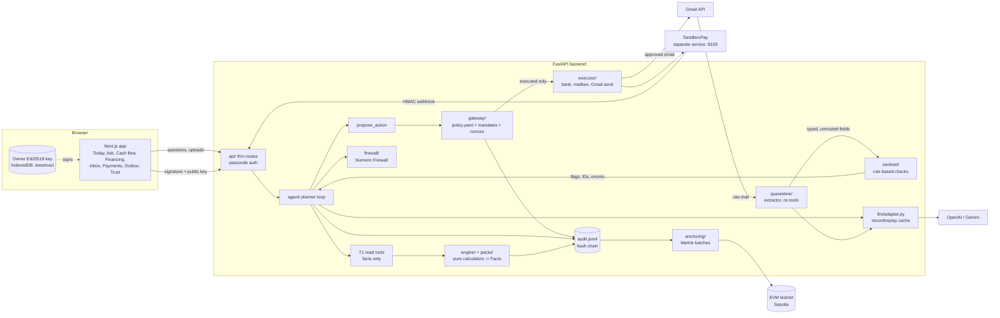
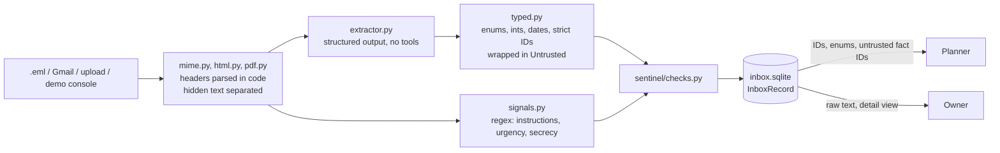
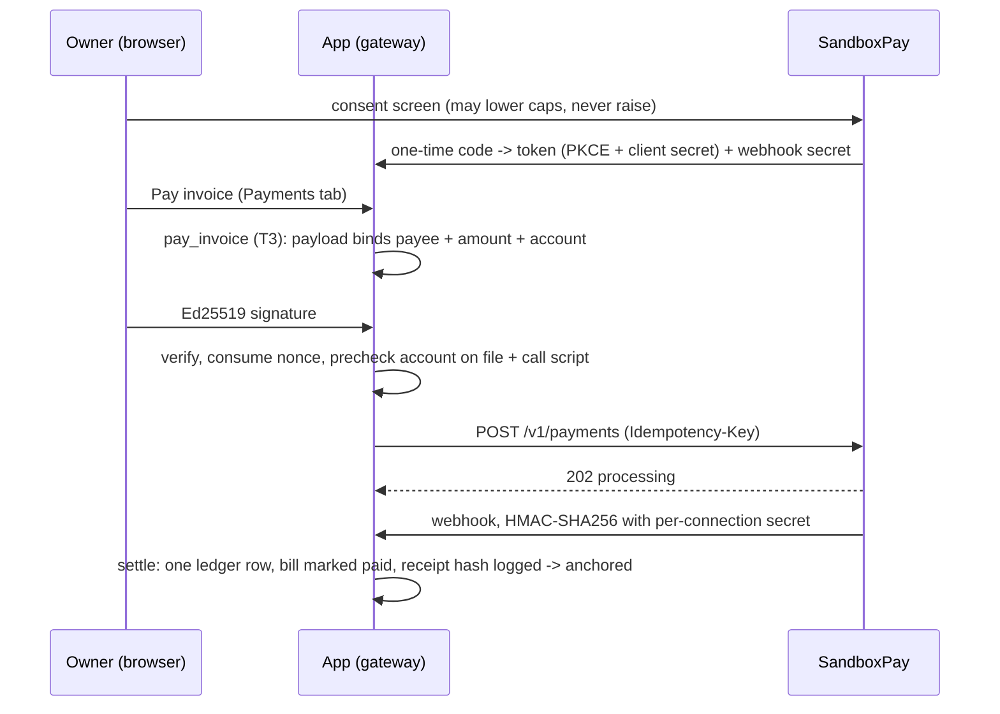

# Technical documentation

How the product works, module by module. All data in this repository is synthetic: the demo businesses are
Maya's Corner Store (grocery) and Lina's Boutique (fashion). Results (test counts, red-team scores, on-chain anchors)
are not repeated here; they live in generated files listed in [evidence/index.md](evidence/index.md). Constants
quoted below (step limits, thresholds) are cited with the file that defines them.

The design rests on nine invariants (see `CLAUDE.md`). The short version: **the LLM proposes, code decides**. The
model can read and explain; it can never move money, send an email or invent a number.

## 1. Architecture



| Layer | Where | Job |
|---|---|---|
| Routes | `backend/app/api/` | Validate with Pydantic, call a domain module, return a model. No business logic. |
| Agent | `backend/app/agent/` | Hand-rolled planner loop, T1 tools, `propose_action`, Morning Brief writer. |
| Finance engine | `backend/app/engine/` | Pure functions `(ledger snapshot, pack, clock) -> list[Fact]`. |
| Skill Packs | `backend/app/packs/`, `skills/` | Per-business-type config compiled from `skill.md`. |
| Numeric Firewall | `backend/app/firewall/` | Fact model, per-request fact store, placeholder renderer, digit check. |
| Quarantine | `backend/app/quarantine/` | Parses untrusted mail and documents; the extractor model has no tools. |
| Sentinel | `backend/app/sentinel/` | Code checks over code-parsed headers and typed fields. |
| Gateway | `backend/app/gateway/` | The only path from a proposal to execution. |
| Executors | `backend/app/executor/` | Side effects; importable only from `app.gateway` (enforced by `tests/unit/test_executor_imports.py`). |
| Audit | `backend/app/audit/` | Append-only, hash-chained JSONL. |
| Anchoring | `backend/app/anchoring/` | Merkle roots of hashes in 0-value testnet self-transactions. |
| LLM | `backend/app/llm/` | The only module that imports `openai`; budget cap, fallback, record/replay. |
| Payment provider | `backend/sandboxpay/` | Separate FastAPI service; imports nothing from `app`. |

**Stack.** Python 3.12, FastAPI, Pydantic v2, SQLite (one file per business under `backend/data/tenants/`),
pandas/numpy, PyNaCl, web3.py. Frontend: Next.js 16 (App Router), Tailwind, shadcn/ui, Recharts, tweetnacl. No agent
framework and no vector database: the loop is one short module (`agent/planner.py`) so every step can be audited.

**Time.** `backend/app/clock.py` is the only source of business dates. It is a simulated clock that only moves forward
(the demo fast-forwards it to trigger the overnight job). Engine functions read only `clock.today()`, so every
result can be replayed.

**Money.** Integer minor units everywhere (`ledger/money.py` parses with `Decimal` and refuses extra decimals).
Formatting happens only when a Fact's `display` is built.

## 2. The agent loop

`backend/app/agent/planner.py`, one turn:

1. System prompt (`llm/prompts/planner.md`) + conversation history + the owner's message go to the adapter with the
   T1 read tools and `propose_action`.
2. Tool calls run in code. Each read tool returns IDs, enums, pack labels and `{fact:<id>}` placeholders, never a raw
   value or any statement or email text. Comparisons the model needs ("below the healthy range", "shortfall likely")
   are computed in code and returned as enums (`agent/tools.py`).
3. The loop repeats until the model replies in text or `MAX_STEPS = 8` tool rounds have run (`planner.py`).
4. The draft reply goes through the Numeric Firewall. On rejection the model gets `FIREWALL_REPROMPTS = 1` re-prompt
   naming the problem; if that fails too, the owner gets template text built in code from the facts the tools
   returned. Rejected drafts are logged and kept out of history.
5. The reply is emitted whole, after the firewall passes it, over SSE. Stage events ("Checking your cash
   position…", "Double-checking every number…") stream while the owner waits (`agent/events.py`).

The planner holds no executor and no gateway object. Its only way to cause anything is `propose_action`
(`agent/actions.py`), which:

- substitutes amounts and dates from facts: an argument is written `{"fact": "<id>"}`, and a literal number is
  refused;
- decides provenance in code: a string argument is `trusted` only if a trusted tool result gave the planner that
  exact value; values from quarantined content are `untrusted`; anything else (made up, or copied from the chat) is
  `untrusted`;
- returns exactly the gateway's status (`executed`, `pending_approval` with an approval ID, or `denied` with the
  rule). The prompt requires the planner to report that status and never claim an action happened otherwise.

Tool names are free text on purpose: a request for a Tier 4 action reaches the gateway, which denies it as an
unknown tool and logs a violation.

**Conversation memory.** Each turn gets a fresh `FactStore` containing only facts that tools returned this turn, or
earlier in the conversation and recomputed now (`agent/context.py`). The model cannot cite a fact ID it remembers
from an old turn unless the value is recomputed.

## 3. Numeric Firewall

Every number or date the owner sees is a `Fact` (`firewall/fact.py`): `id`, `value`, `unit`, `display`,
`source_row_ids`, `inputs`, `computed_by`. The LLM writes `{fact:<id>}`; `firewall/render.py` substitutes `display`.

- **Digit check** (`firewall/digit_check.py`): text passes only if every number-like character sits inside a
  well-formed ASCII placeholder. "Number-like" covers any Unicode numeric character (Arabic-Indic, fullwidth,
  superscripts, fractions, Roman and CJK numerals) and any character whose NFKC form contains one. A lookalike
  placeholder written with fullwidth braces is not a placeholder. The check cannot catch numbers spelled as words; the
  prompt forbids them.
- **Fact store** (`firewall/store.py`): one per request, no module-level store. The renderer resolves only IDs
  computed for this request.
- **Trace** (`firewall/explain.py`): `explain_fact` walks a fact back through `inputs` to ledger rows, sale lines,
  scheduled items, Skill Pack config (`pack:` references) or owner answers (`owner:` references). The owner-facing
  call includes row text; the planner's call never does.
- **Where it applies:** chat replies, the Morning Brief (`agent/brief.py`, same reject → re-prompt → template
  sequence), action reasons on approval cards, Passport reasons, and outgoing email drafts
  (`agent/email_compose.py`). Numbers that come from `owner:` references are digits the owner typed, not LLM output.

## 4. Quarantined extractor and the Inbox Sentinel

Untrusted content (email, PDF, invoice photo, upload) never reaches the planner as text.



- **Parsing in code.** `quarantine/mime.py` reads sender, display name, Reply-To, SPF/DKIM/DMARC verdicts and
  attachment hashes. `quarantine/html.py` and `quarantine/pdf.py` split visible text from text a human cannot see
  (CSS `display:none`, white or tiny text, PDF render mode 3).
- **Extractor** (`quarantine/extractor.py`): the adapter's `structured()` entry point with the `extractor` role,
  which raises if anyone passes tools. The document is fenced and labelled as untrusted data. Output must validate
  against a per-kind schema (`quarantine/schemas.py`). The schemas have no free-text summary field, so the model cannot
  restate an injected instruction. Invalid output is discarded and logged, never repaired.
- **Typed fields** (`quarantine/typed.py`): the only shape that leaves quarantine. Every value is an enum, bool,
  integer, date or a short string matching a strict pattern, wrapped in `Untrusted`. Account numbers are tokenized
  with the tenant's PII key; only the last four characters are kept, for the owner's screen.
- **Signals** (`quarantine/signals.py`): deterministic patterns over the raw text, hidden text included, OR-ed with the
  model's flags, so a model that is talked out of flagging an instruction is overruled.

**Sentinel** (`sentinel/checks.py`): pure code over parsed headers, typed fields and the business's own records
(contact book and ledger, never email). Flags: `lookalike_domain` (homoglyph folding plus edit distance,
`sentinel/domains.py`), `display_name_spoof`, `reply_to_mismatch`, `bank_detail_change`, `first_time_payee`,
`amount_anomaly` (above 1.5× the largest payment to a known payee, or 10× the median outgoing payment for a new one;
constants in `checks.py`), `urgency`, `instruction_like_text`, `hidden_text`, `receipt_total_mismatch`,
`duplicate_invoice`, `amount_mismatch`. A high-severity flag on a payment message sets `hold`. The owner then sees a
call-back script and must mark the call done before a payment can run. If the extraction failed (model down or
invalid output) and a high-severity flag fired, the message is held, because nothing shows it is not asking for money.

Which checks need the model: `lookalike_domain`, `reply_to_mismatch`, `display_name_spoof`, the urgency and
instruction text patterns and `hidden_text` are rule-based and work with no model. `bank_detail_change`,
`first_time_payee`, `amount_anomaly`, `amount_mismatch`, `duplicate_invoice` and `receipt_total_mismatch` need the
extractor's reading first (`services/demo_console.py`, `RULE_BASED_CHECKS` / `MODEL_ASSISTED_CHECKS`).

Clean mail from a known counterparty (a promise to pay, a purchase order, an invoice due date) feeds the forecast
as `scheduled_items` with a `mailbox_*` source (`quarantine/feed.py`). Those amounts reach the planner as untrusted
facts. A flagged email never moves the forecast.

## 5. Gateway and tiers

`backend/app/gateway/engine.py` decides every proposal against `backend/app/gateway/policy.yaml`. The default
decision is deny.

| Tier | Execution | Tools (from `policy.yaml`) |
|---|---|---|
| T1 | Autonomous, read/compute only | `get_*`, `list_*`, `explain_fact`, `match_financing`, `get_passport`, `rank_products_for_ads`, `product_performance`, `ad_budget_what_if` |
| T2 | Under a signed standing mandate with hard caps | `send_invoice_reminder`, `pay_recurring_bill` |
| T3 | Owner signs the exact payload | `submit_loan_application`, `pay_invoice`, `change_payee_details`, `delay_supplier_payment`, `send_supplier_message`, `cancel_subscription`, `send_email` |
| T4 | Not implemented, by design | none; `large_debt`, `hiring_or_firing`, `pricing_change`, `deal_commitment` are refused categories |

Caps and per-tool rules are listed in [security-self-assessment.md](security-self-assessment.md#1-tiers-tools-and-caps).

Rules the gateway applies, in order:

1. **Arguments.** `gateway/dispatch.py` `ACTION_ARGS` declares each action's arguments and types; a mismatch is
   rejected before any policy check.
2. **Tier lookup.** Fails closed: a tool not named under T1–T3 is denied and logged as a violation. T2/T3 entries must
   be exact names, so a new action cannot enter through a glob. The system tool `anchor` is not proposable.
3. **Provenance (invariant 3).** Any `untrusted` argument escalates the action to T3. `send_email` has
   `deny_untrusted_args`: it is denied instead, so content from an email can never make the assistant email
   anyone, even with a signature.
4. **T2.** Runs only under an active, unexpired, signed standing mandate. The mandate's terms may lower the
   policy caps but never raise them. A cap, allow-list or frequency breach is denied, not escalated.
5. **T3.** Stored as a pending approval with the payload to sign. It expires after `approvals.ttl_days`.
6. **Prechecks** (`Executors.precheck`, run on proposal and again just before execution): a loan application must
   name an intact draft for the same product and amount; `pay_invoice` is refused if the payee's account on file
   changed or a flagged-email request lacks its call verification; `send_email` is refused if the draft was altered,
   the recipient is not a known contact or owner-added address, or the recipient sent a flagged email.

`approve()` verifies in order: the signer's key is enrolled for the business, the Ed25519 signature covers the
stored payload, the payload has not expired, any out-of-band call is confirmed, and the nonce is unused. The nonce
is consumed (an `INSERT` on a primary key, atomic under concurrency) before the executor runs. Every decision,
stored mandate and execution is appended to the audit log.

## 6. Mandates and signing

`backend/app/gateway/mandate.py`, `frontend/lib/owner-key.ts`.

- The owner's Ed25519 key pair is generated with tweetnacl on first use and stored in the browser's IndexedDB.
  Only the public key leaves the browser. It is enrolled trust-on-first-use per business: after the first key, any
  other key is refused, so knowing the passcode is not enough to add a signer.
- The signed message is the canonical JSON of `{action, args_hash, nonce, expiry}` (sorted keys, no insignificant
  whitespace, UTF-8, floats refused: `audit/canonical.py`). The browser produces the same bytes with
  `JSON.stringify` over the four keys in sorted order.
- **Approval (T3):** `args_hash` is the hash of the exact action arguments. For a loan application or an email, the
  arguments include a draft ID derived from the SHA-256 of the canonical draft, so the signature covers every byte
  of the document. Editing an email draft (`revise-email`) creates a new draft and a new approval and closes the old
  one, so a signature over the old text can never send new text.
- **Standing (T2):** `args_hash` is the hash of `StandingTerms` (caps and allow-list). The mandate may last at most
  `standing_mandate_max_days` from `policy.yaml`.
- Each stored mandate keeps its canonical hash, which the next anchoring batch includes.

## 7. Skill Packs and skill.md

A Skill Pack is everything that differs between kinds of business, as config. On the same ledger it changes
categorization, forecast seasonality, KPIs and healthy ranges, which leak detectors run with which thresholds,
financing fit, Readiness Passport weights, onboarding data needs and "what you didn't think of" advisor questions
(`packs/schema.py`).

- **Format:** one Markdown file; YAML frontmatter holds the pack and the body describes the business type for the
  owner. Documented in [skills/FORMAT.md](skills/FORMAT.md). Built-in: `skills/grocery.skill.md`,
  `skills/fashion.skill.md`, `skills/general.skill.md`; community example: `skills/bakery.skill.md`.
- **Compile = security boundary** (`packs/skill.py`). Strict schema (unknown fields, YAML aliases and non-plain values
  rejected). Detectors are referenced by registered name only (`packs/registry.py`); a skill sets thresholds and can
  never add code. Reserved keys (`policy`, `tiers`, `caps`, `mandates`, `gateway`, `tools`…) are rejected anywhere.
  Instruction-like text is rejected in the frontmatter and flagged in the body. Raw HTML is rejected.
- **Labels never reach the planner from an unverified skill.** Planner-visible labels are rebuilt in code from IDs;
  the uploader's wording is shown only in the owner's preview.
- **Trust badge:** "Verified" if signed with the library Ed25519 key (`packs/library_key.py`; the signed message is
  domain-separated from owner mandates), otherwise "Community, unverified".
- **Answers** (`packs/answers.py`): each advisor question declares its effect: an owner-stated Fact (`owner.<fact>`)
  or a per-business override of one detector parameter. The pack file never changes.
- Uploads, rejections and activations are audit-logged; an accepted skill's hash is an anchoring leaf.
- `make validate-skill FILE=...` runs the same compile path as an upload.

## 8. On-chain anchoring

`backend/app/anchoring/`. Purpose: tamper evidence for the audit log against an insider who rewrites the file and
recomputes every hash, which a local chain check cannot detect.

**What is anchored:** only hashes. Leaves are the current audit-log head, every newly stored mandate hash, every
exported Passport hash, every accepted skill hash and every payment receipt hash in the range since the last batch.
Never business data, names, amounts or PII.

**Merkle tree** (`anchoring/merkle.py`): index-based SHA-256 with RFC 6962-style domain separation.

```
leaf = SHA256(0x00 || utf8("<kind>:<hash hex>"))     # kind is bound into the leaf
node = SHA256(0x01 || left || right)                  # ordered; proofs record each sibling's side
odd node at a level -> promoted unchanged             # never duplicated (avoids CVE-2012-2459)
one leaf -> root = leaf hash, empty proof
```

**Transaction** (`anchoring/chain.py`): a 0-value self-transaction (`to == from`) whose `data` is exactly the 32-byte
root, signed with a throwaway faucet-funded key. The chain ID is checked against the allow-list (Sepolia 11155111,
Base Sepolia 84532) at config load and again against the ID the RPC reports, so a mainnet URL is refused before
anything is signed. web3 exceptions are reduced to their class name because RPC URLs often embed an API key.

**Batching** (`anchoring/service.py`): a batch is cut every `ANCHOR_BATCH_SIZE` audit entries (default 20 in
`config.py`; anchoring's own entries do not count), at the end of each demo scenario (clock fast-forward, owner
signature, Passport export) and on demand ("Anchor now" on the Trust screen, or `make anchor`). Cutting is a local
read and insert; a worker thread sends. On RPC failure the batch stays queued, the failure is logged without RPC
details, and it retries with exponential backoff. Sends are rate-capped by `policy.yaml` (`system_tools.anchor`).

**Verification.** `GET /audit/verify` recomputes the chain locally, then for each anchored batch recomputes the
leaves from the log, mandates and Passports, rebuilds the root and compares it with the `data` of the transaction
fetched from the chain. Per-document checks (a mandate, a Passport file a lender holds) recompute the document's
hash and verify its Merkle proof against the anchored root. `make anchor` writes `docs/results/anchors.json`;
`make evidence` re-verifies every batch offline from the recorded chain responses in `backend/data/replay/rpc/`.

## 9. Payments (SandboxPay)

SandboxPay (`backend/sandboxpay/`) is a simulated payment provider that runs as its own service on :8100, with its
own database and its own limits. It imports nothing from `app`, so its caps hold even if the app and its gateway were
compromised.



- The payee's account comes from the contact book or a signed `change_payee_details`, never from an email. An amount
  from an email is untrusted, so the payment is T3 even if a standing mandate would otherwise cover it.
- `pay_recurring_bill` (T2) runs only when a standing mandate covers the exact payee and amount and every value is
  trusted (`Gateway.mandate_covers`).
- Idempotency on both sides: the app never resends a key the provider accepted, and the provider refuses a reused
  key with a different body (409). Double clicks, retries and replayed webhooks cannot pay twice.
- Settlement happens only on a webhook whose HMAC verifies and whose provider ID, amount and idempotency key match
  the request. Tokens and webhook secrets are encrypted at rest (XSalsa20-Poly1305, `connections/crypto.py`) and
  never returned by the API, logged or shown to the planner.
- `pay_invoice` is not in the planner's action catalogue (`agent/actions.NOT_FOR_PLANNER`): payments start from the
  Payments tab.

## 10. Gmail

`backend/app/connections/gmail.py`, `backend/app/services/gmail.py`, `backend/app/executor/gmail_sender.py`.

- OAuth authorization-code flow with PKCE and a one-time `state` bound to the business, valid for ten minutes.
  Scopes: `gmail.readonly` and `gmail.send` only. The refresh token is encrypted at rest per business and never
  leaves the server.
- **Reading:** a poller fetches new mail (only mail after connecting, unless the owner imports the last 7 days) and
  hands the raw RFC 822 message to the same quarantine → sentinel pipeline as the sandbox mailbox. Live stages
  (received → extracting → checking → accepted/flagged/held) stream to the Inbox screen over SSE.
- **Sending:** only `executor/gmail_sender.py` calls Gmail's send endpoint, reached through the gateway after an
  `executed` decision. `executor/mail_sender.py` sends for real only if Gmail is connected and active, the recipient
  is a known contact with an address on file, and that address is on `DEMO_SEND_ALLOWLIST`. Everything else goes to
  the labelled sandbox outbox, so a rehearsal can never email a real customer.
- **Emails as actions:** `send_email` is T3. The planner or the overnight job writes subject and body with fact
  placeholders; code renders them through the Numeric Firewall into a content-addressed draft; the gateway sees only
  `recipient_id` and `draft_id`. Never sent to the sender of a flagged email; that sender gets the call script.
- Audit entries carry the account's domain and a hash of the address, never tokens or message text.

## 11. Forecast

`backend/app/engine/forecast.py`. 30/60/90-day daily cash forecast and runway, pure and explainable.

```
flow(d) = seasonality(d) × (baseline_in[weekday(d)] − baseline_out[weekday(d)]) + scheduled(d)
```

- **Baseline:** per weekday, the mean deseasonalized inflow and outflow over the last `LOOKBACK_DAYS = 56` complete
  days (eight of each weekday), from categories the pack does not mark `scheduled`. Each history day is divided by
  its own seasonality multiplier first, so a past festival spike does not inflate the baseline.
- **Seasonality:** the pack's month multiplier × the holiday multiplier of any calendar window covering the day.
  Holiday dates come from the business's calendar (config); the pack supplies the multiplier per holiday type.
- **Scheduled items:** open payables and receivables (rent, payroll, customer invoices) in `scheduled` categories, on
  their due dates. Items already represented by the baseline are counted, not added. Overdue payables are assumed
  paid today; overdue receivables are left out of the expected path. A customer's promise to pay from a clean email
  supersedes the invoice it refers to, so its cash is counted once, on the promised date.
- **Band (about 80%):** σ is the standard deviation of daily baseline residuals; after h days the band is
  `Z × σ × √h` with `Z = 1.2816`. The low path also drops receivables not yet collected; the high path collects every
  overdue receivable today. This is a simple, explainable spread, not a formal confidence interval.
- Every forecast fact cites the rows and scheduled items it used, so `explain_fact` traces a projected balance back
  to statement lines.

Repayment-safe loan sizing (`engine/financing.py`) builds on this: it uses the 90-day forecast, a stressed revenue
drop scaled by gross margin, and the lowest bad-case balance, so installments never take the bad case below zero.

## 12. Ad advisor

`backend/app/engine/ad_advisor.py`, tools in `backend/app/agent/ads_tools.py` (all T1).

- **Per product:** margin, profit per unit, units-sold trend (last 30 days vs the 30 before), stock on hand and days
  of cover, return rate, ad spend, attributed revenue, return on ad spend (ROAS), and profit after ad spend (the
  margin on attributed sales minus the spend). Windows: `AD_WINDOW_DAYS = 90`, `MARGIN_WINDOW_DAYS = 90`,
  `TREND_DAYS = 30`.
- **Ranking ("worth promoting")** with exclusions computed in code: `low_stock_cover` (restock first),
  `negative_profit_after_ads` (a thin-margin product can lose money even above 1.0× ROAS), `high_return_rate`.
  Thresholds come from the Skill Pack's `losing_ad_campaigns` and `product_returns` detector params, so one pack
  file tunes both the leak finder and the advisor.
- **What-if:** move an amount from campaign A to B. The estimated change in gross profit is a low/high range from
  each campaign's historical return over the last `WHATIF_RECENT_DAYS = 30` and `WHATIF_LONGER_DAYS = 90` days,
  capped at `WHATIF_CAP_MULTIPLIER = 1.5` × the destination's historical spend so a small campaign's return is not
  extrapolated to an unrealistic budget. Labelled as an estimate. The calculator returns fresh Facts tracing to
  the campaigns' spend rows, registered in the turn's fact store so the firewall can render them.
- Follow-up questions ("why not the best seller?", "what if I move X from A to B?") reuse the conversation's facts.
  Changing real ad accounts is out of scope.

## 13. LLM adapter, budget and replay

`backend/app/llm/adapter.py` is the only module that imports `openai` (`tests/unit/test_llm_imports.py`).

- **Profiles:** `dev` uses `gpt-5.6-terra` for every role; `demo` uses `gpt-5.6-sol` for the planner and brief writer
  and Terra for the extractor.
- **Fallback** to Gemini Flash (OpenAI-compatible endpoint) on `insufficient_quota`, 429, 5xx, timeout, connection
  failure, or once the local `LLM_BUDGET_USD` cap is reached. Gemini 429s back off and retry. A bad request is raised,
  never masked by a fallback.
- **Spend:** every call is priced from returned token usage (`llm/pricing.py`, integer micro-USD, unknown models
  priced at the highest known rate) and persisted, so the cap survives restarts.
- **Record/replay** (`llm/cache.py`, `LLM_REPLAY=record|replay|off`): a request is keyed by the SHA-256 of
  model-independent content; each recording is one readable JSON file. Tests and CI always replay, with no keys and no
  network. Recordings live per provider: `backend/data/replay/llm/` (OpenAI, dev profile; what CI replays),
  `backend/data/replay/openai-demo/llm/` (OpenAI, demo profile), `backend/data/replay/gemini/llm/` (Gemini). The same
  cache, namespace `rpc`, mocks the anchoring RPC.
- Every call is audit-logged with role, provider, model, tokens, cost, cache status and the request key. Message
  content is never logged.

## 14. Audit log

`backend/app/audit/log.py`. One line per entry: `{seq, date, kind, data, prev_hash, hash}`, where `hash` is the
SHA-256 of the canonical JSON of the entry without `hash`. Editing, inserting, deleting or reordering any line breaks
the chain from that point, and `verify()` reports the first bad sequence number. The file is only opened in append
mode, and nothing writes to it except `audit.append()`. PII is tokenized before it can reach the log; message bodies
are logged as hashes.

## 15. Onboarding and the demo console

- **Onboarding** (`services/onboarding.py`, `/start`): name and type pick the Skill Pack; starting cash, bills and the
  pack's data needs are asked one at a time; CSVs go through the normal ingestion path; PDFs and receipt photos go
  through quarantine, and their amounts stay pending until the owner approves them (and stay untrusted afterwards);
  inbox connection; starter limits drafted for the owner to sign; first Morning Brief. No LLM decides anything in
  onboarding. `make demo-reset` removes businesses created this way.
- **Demo console** (`/demo-console`, only with `DEMO_MODE=true` and `NEXT_PUBLIC_DEMO_MODE=true`): a simulated sender
  that writes preset or custom mail (lookalike domains, spoofed senders, bank-detail changes, hidden instructions)
  into the sandbox mailbox, written from the open business's own records. Delivery goes through the real quarantine
  → sentinel path with a live model (never replay). It cannot trigger an action.
